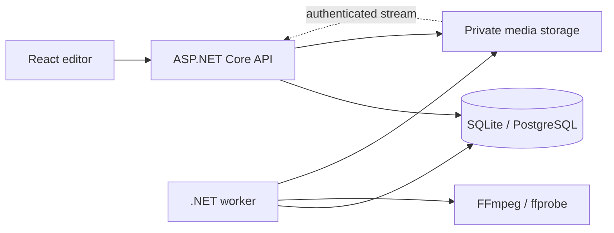

# FrameLab

**Bir fikrin ilk karesi.** Tarayıcıda çalışan, kendi API ve render worker'ı olan video kurgu stüdyosu.

React ve TypeScript ile hazırlanan zaman çizelgesi; ASP.NET Core API üzerinden projeyi kaydeder. Ayrı bir .NET worker, FFmpeg ile gerçek H.264/AAC MP4 üretir. Harici yapay zekâ servisi veya ücretli API anahtarı gerekmez.

## Neler yapar?

- Parçalı, SHA-256 doğrulamalı ve kaldığı yerden devam edebilen medya yükleme.
- Video ve ses kitaplığı, poster ve dalga biçimi oluşturma.
- Klipleri sıralama, kırpma, bölme, çoğaltma ve silme; geri al / yinele.
- Klip başlığı, konum, ses seviyesi, susturma ve siyaha açılma / kararma.
- Fon müziği, yatay / dikey / kare çerçeve ve 720p / 1080p çıktı.
- Otomatik kayıt, sürüm çakışması uyarısı, taslağı indirme ve geçmiş sürümü geri yükleme.
- Proje sahibi, düzenleyici ve izleyici rolleri; zaman kodlu yorumlar.
- Kalıcı iş kuyruğu, worker lease / heartbeat, ilerleme, çıktı iptali ve tekrar deneme.
- Yetkilendirilmiş ve HTTP Range destekli önizleme / çıktı indirme.

## Yerelde başlat

Gereksinimler: **Node.js 24**, **.NET SDK 10**, **FFmpeg + ffprobe** (drawtext destekli) ve Windows'ta Arial / Linux'ta DejaVu Sans.

Windows PowerShell:

```powershell
./scripts/start.ps1
```

Tarayıcı: **http://127.0.0.1:9260**. Yerel geliştirme hesapları: `berkay` ve `deniz`; parola `Framelab2026!`. Bu hesaplar yalnızca Development ortamında örnek kullanım içindir. İlk girişte **Örnek projeyi aç** ile telifsiz, uygulamanın kendi ürettiği iki sahneyi deneyebilirsin.

FFmpeg'i [resmî indirme sayfasındaki](https://ffmpeg.org/download.html) platform bağlantılarından kur. Windows sürümleri için [Gyan builds](https://www.gyan.dev/ffmpeg/builds/) kullanılabilir. `ffmpeg` ve `ffprobe` PATH üzerinde bulunmalı veya `FFmpegPath` / `FFprobePath` tanımlanmalı. FFmpeg binary dosyaları bu depoya eklenmez; kendi lisans koşullarına tabidir.

### Docker + PostgreSQL

```sh
cp .env.example .env
# .env içindeki iki örnek parolayı değiştir
docker compose up --build
```

**http://localhost:9260** adresini aç. Kullanıcı `berkay`, parola `.env` içindeki `ADMIN_PASSWORD`. Production ortamı demo parolasını ve ikinci hesabı oluşturmaz. Veritabanı ve özel medya Docker volume'lerinde tutulur. API dışarıya ayrı bir port açmaz. İnternete yayınlama için TLS, yedekleme ve kaynak limitleri ayrıca yapılandırılmalı.

## Mimari



Kuyruk veritabanında kalıcıdır; RabbitMQ bağımlılığı yoktur. Worker 20 saniyelik lease alır ve heartbeat ile yeniler. Her deneme ayrı çalışma klasörü kullanır. Sonucun yayımlanması lease sahibine bağlıdır. Render, başlatıldığı proje sürümünün değişmez kopyasını işler; sonradan yapılan düzenleme çıktıyı değiştirmez.

| Katman       | Teknoloji                                      |
| ------------ | ---------------------------------------------- |
| Web          | React, TypeScript, Vite, Lucide                |
| API / Worker | ASP.NET Core / .NET 10                         |
| Veritabanı   | EF Core, SQLite; Docker'da PostgreSQL          |
| Medya        | FFmpeg, ffprobe, H.264, AAC                    |
| Depolama     | Özel dosya deposu, isteğe bağlı S3 uyumlu ayna |
| Kontroller   | Node test runner, Playwright, GitHub Actions   |

## Geliştirme ve test

```sh
npm ci
npm run build
dotnet build src/FrameLab.Api
dotnet build src/FrameLab.Worker
# API ve worker Development ortamında çalışırken:
npm test
# Web de çalışırken:
npx playwright install chromium
npx playwright test
```

API testi gerçek örnek medya üretir, MP4 render eder, indirme / Range, erişim kontrolü, oturum iptali, idempotent render ve sürüm çakışmasını kontrol eder. Testler ayrı, boş bir geliştirme veritabanına karşı çalıştırılmalıdır. GitHub Actions bu ortamı her çalıştırmada oluşturur.

## Kapsam ve sınırlar

Bu sürüm kısa video kurgusu için çalışan bir portföy uygulamasıdır. Proje başına en fazla 12 klip / 180 saniye, dosya başına 200 MB / 10 dakika / 4K kabul edilir. Tek API instance'ı yükleme koordinasyonunu yürütür; worker ayrı süreçtir. Gerçek zamanlı ortak imleç, keyframe, renk düzenleme, cross-dissolve, GPU render ve mobil native uygulama içermez. Tarayıcı önizlemesi proxy videoyu kullanır; son çıktı orijinalden kodlanır.

Veritabanı ilk açılışta `EnsureCreated` ile V1 şemasını kurar; bu sürüm şema yükseltme migration'ı sunmaz. Medya ve iş çalışma dosyaları otomatik temizlenmez; disk kullanımını takip et. Kullanım ve yapılandırma ayrıntıları: [operasyon notları](docs/operations.md).

## Lisans

Uygulama kaynak kodu MIT lisanslıdır. Yüklenen video ve müziklerin kullanım hakları kullanıcıya aittir.
